

  

# What is Lution?

Lution is a linux bootstrapper for Sober (sober is roblox for linux made by vinegarhq.org)

# how to download lution
just go into the releases lol

# how to run source code

1. download source code and unzip
2. install python and tk using your native package manager (or also called python-tkinter or tkinter)
3. open a terminal and cd into the source code folder and run "python main.py" and lution will launch

# screenshots

  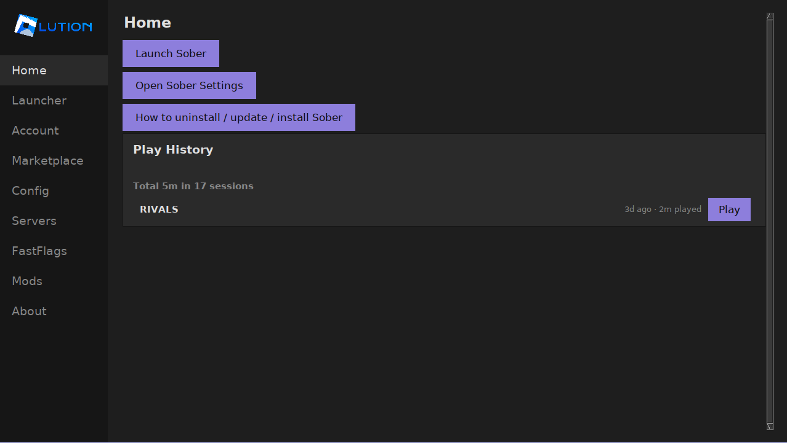

  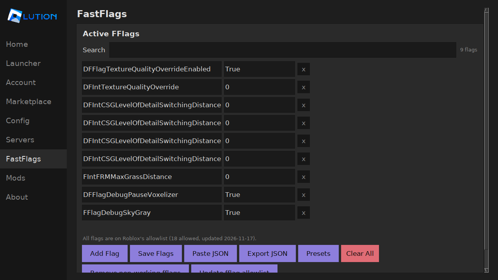

  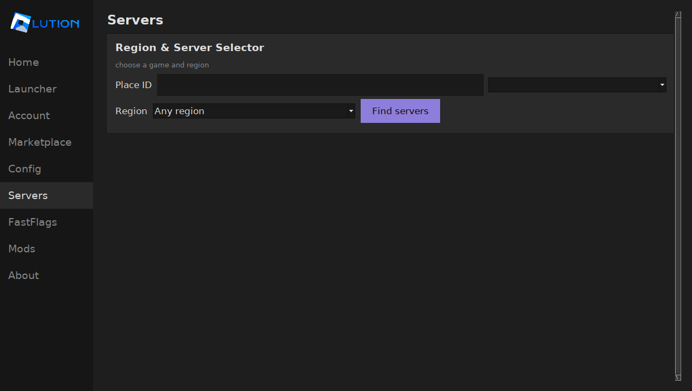

  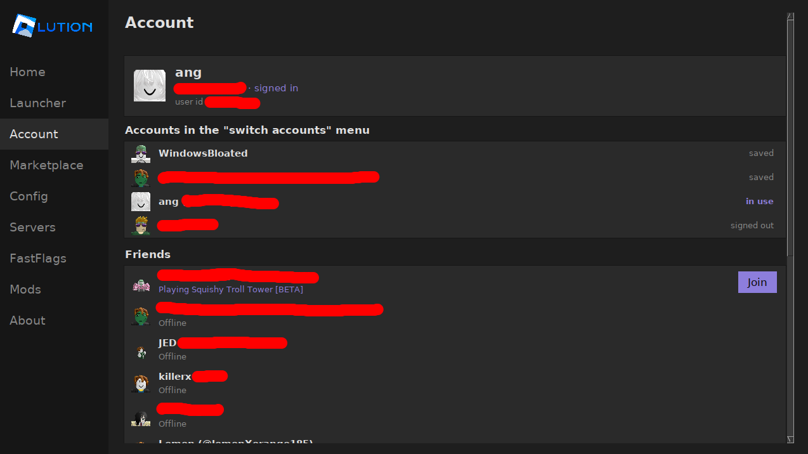

  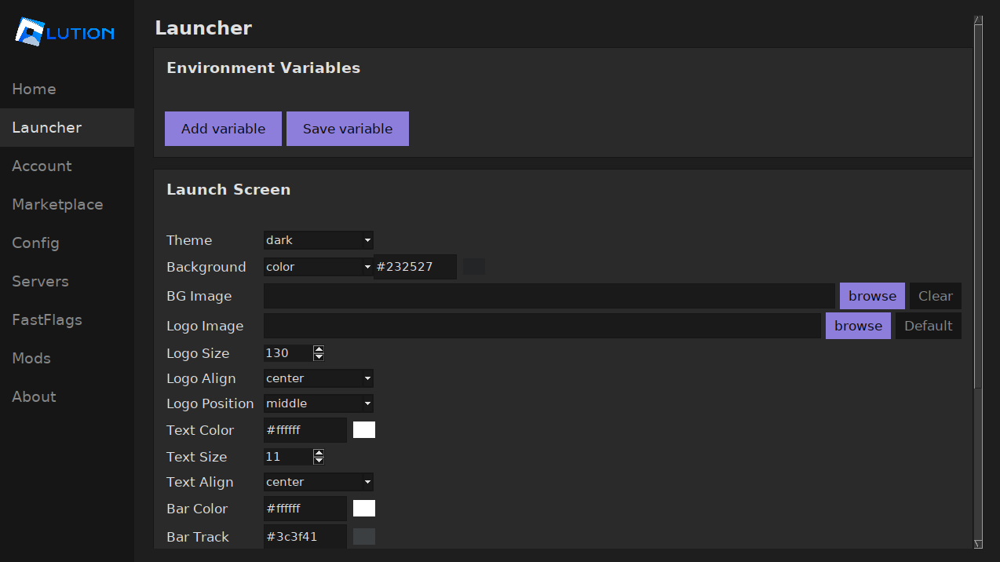

  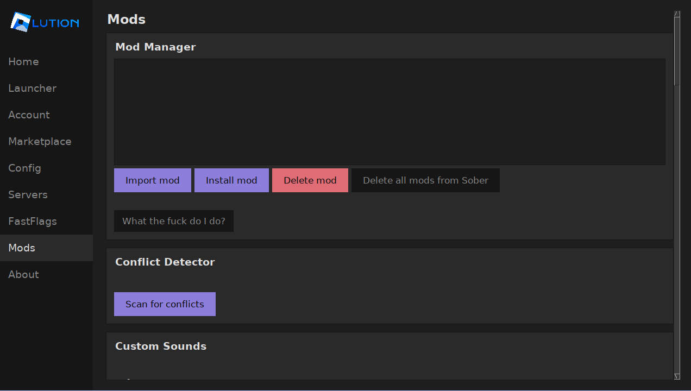

  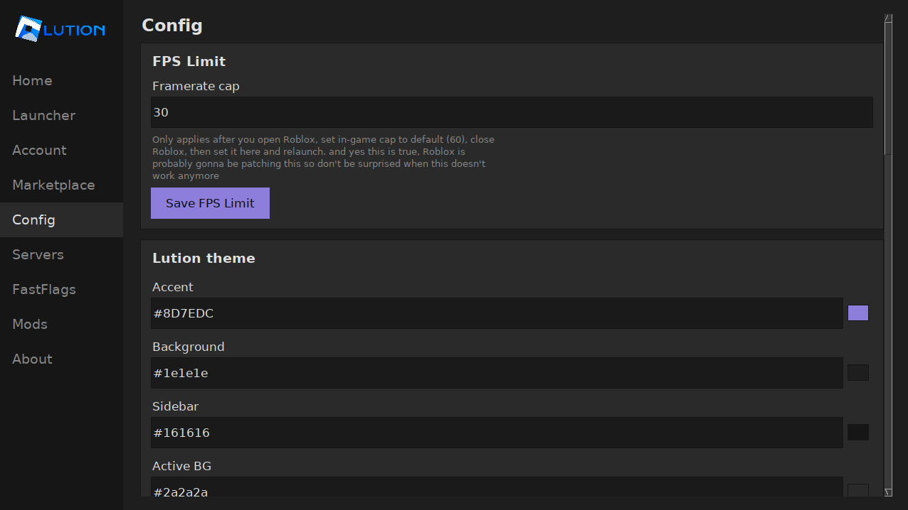

  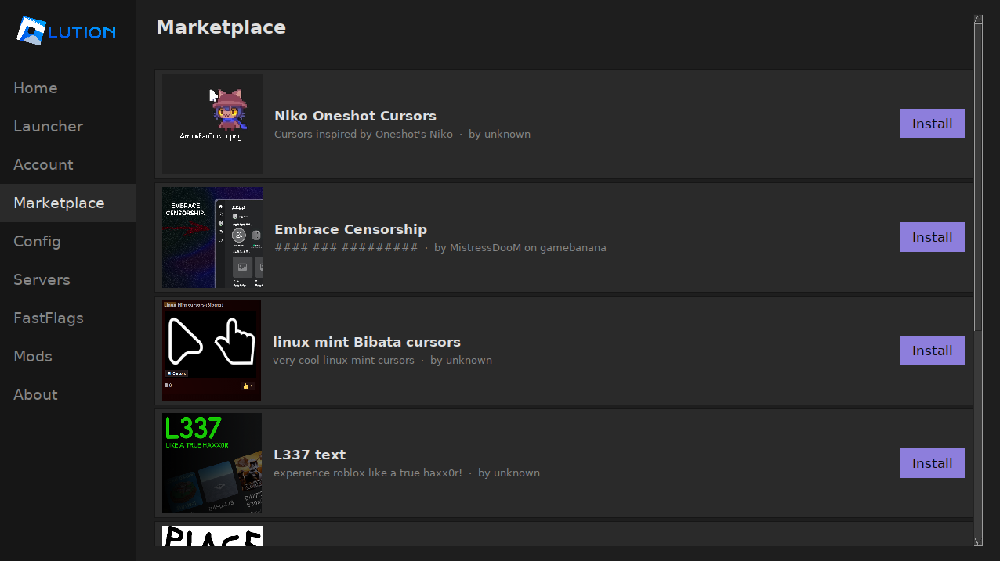

  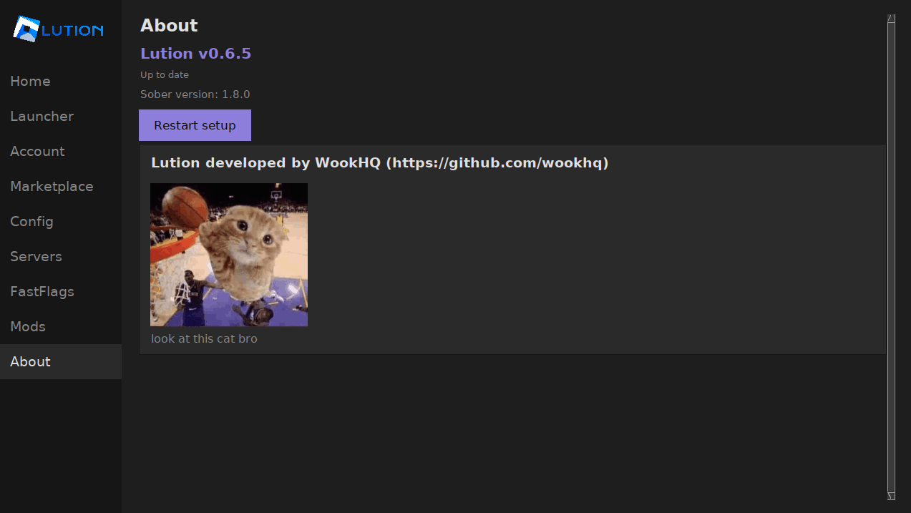

  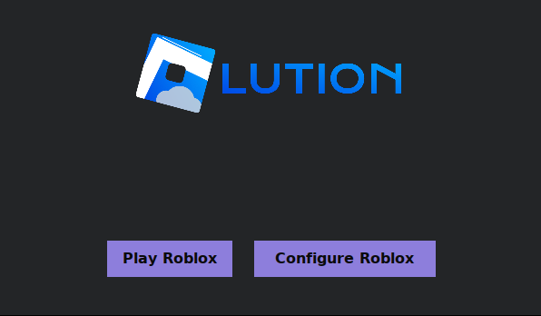

  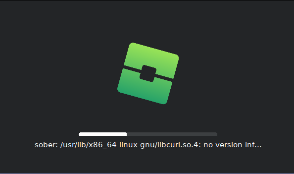

